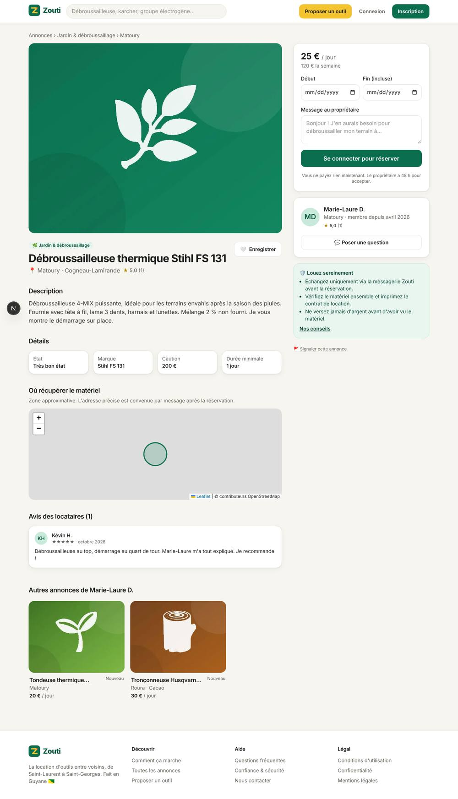
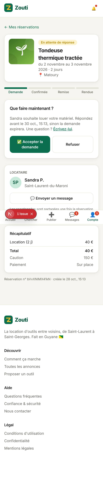
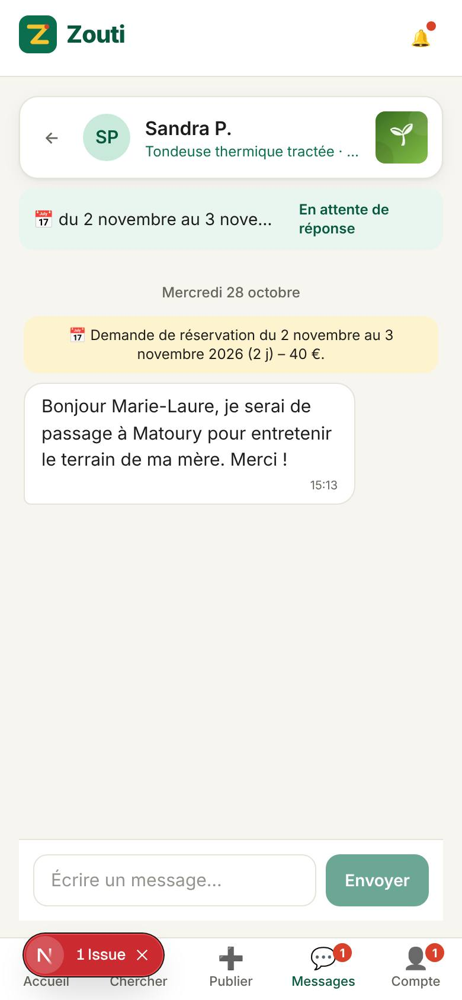

# Zouti – location d'outils entre particuliers en Guyane

**Zouti** (« outils » en créole) est une application web de location de matériel entre voisins, pensée pour la Guyane : débroussailleuse, nettoyeur haute pression, groupe électrogène, barnum, kayak… Elle reprend le principe de [Bricolib](docs/ANALYSE-BRICOLIB.md) en l'adaptant au territoire (22 communes, matériel local, paiement en main propre, WhatsApp, connexions mobiles lentes).

C'est une **web app installable sur téléphone (PWA)**, prête à être déployée.

| Accueil | Annonce | Demande reçue (mobile) | Messagerie (mobile) |
|---|---|---|---|
|  |  |  |  |

## Fonctionnalités

| Pour tous | Locataire | Propriétaire | Équipe |
|---|---|---|---|
| Inscription / connexion, mot de passe oublié, vérification e-mail | Recherche par mot-clé, catégorie, commune, dates de disponibilité, prix, livraison | Annonce avec jusqu'à 6 photos (compressées automatiquement), prix jour/semaine, caution, durée minimale | Tableau de bord (membres, annonces, volume) |
| Profil public avec avis, taux de réponse, badges | Vue liste ou **carte** (zone approximative, jamais l'adresse exacte) | Calendrier : bloquer des dates | Traitement des signalements |
| Messagerie intégrée (actualisation automatique) | Demande de réservation avec calcul du prix en direct | Accepter / refuser sous 48 h (expiration automatique) | Masquer une annonce, suspendre un membre (avec notification) |
| Notifications dans l'app + e-mails | Coordonnées et lien WhatsApp après confirmation | Confirmer la remise puis le retour | Comptes admin via `ADMIN_EMAILS` |
| Favoris, signalement | Annulation gratuite jusqu'à la veille | Revenus cumulés | |
| CGU, confidentialité, mentions légales, FAQ, conseils | **Contrat de location imprimable** avec état des lieux | Paiement en ligne via Stripe Connect (facultatif) | |

Règles métier : pas de double réservation (verrou en base), refus automatique des demandes qui se chevauchent quand une est acceptée, avis mutuels uniquement après une location terminée, dates calculées à l'heure de Guyane (UTC−3).

## Stack

- **Next.js 16** (App Router, Server Actions) + React 19 + TypeScript
- **PostgreSQL** via Drizzle ORM (migrations versionnées dans `drizzle/`, appliquées automatiquement au démarrage)
- Tailwind CSS 4, Leaflet + OpenStreetMap
- Photos stockées en base (WebP compressé via `sharp`) : rien d'autre à héberger
- E-mails SMTP (Brevo, Mailjet, OVH…) et paiements Stripe **facultatifs**
- Tests : Vitest (unitaires + intégration sur vraie base) et Playwright (parcours complet sur mobile)

## Démarrer en local

Prérequis : Node.js 20.9+ et PostgreSQL (ou Docker).

```bash
cp .env.example .env            # puis ajustez DATABASE_URL si besoin
npm install
npm run db:migrate              # crée les tables
npm run db:seed                 # facultatif : membres et annonces de démonstration
npm run dev                     # http://localhost:3000
```

Comptes de démo après `db:seed` : `marie@demo.zouti.gf` / `zouti-demo` (et kevin@, sandra@, jean@, aline@, yannick@). Le compte admin est `admin@zouti.gf` / `zouti-admin` si `ADMIN_EMAILS=admin@zouti.gf`.

**Avec Docker** (base + application) : `docker compose up -d --build`, puis http://localhost:3000.

## Variables d'environnement

| Variable | Obligatoire | Rôle |
|---|---|---|
| `DATABASE_URL` | oui | Connexion PostgreSQL (`?sslmode=require` pour une base hébergée) |
| `APP_URL` | oui | URL publique (liens des e-mails, retours de paiement). En `https://`, le cookie de session est sécurisé. |
| `ADMIN_EMAILS` | conseillé | E-mails qui obtiennent le rôle administrateur à l'inscription / connexion |
| `SMTP_HOST`, `SMTP_PORT`, `SMTP_USER`, `SMTP_PASSWORD`, `SMTP_FROM` | non | Envoi des e-mails. **Sans SMTP**, les e-mails sont écrits dans les logs et les comptes sont considérés comme vérifiés. **Avec SMTP**, la vérification d'e-mail est exigée pour publier et réserver. |
| `STRIPE_SECRET_KEY`, `STRIPE_WEBHOOK_SECRET`, `SERVICE_FEE_PERCENT` | non | Paiement en ligne. Sans ces clés, tout se règle en main propre, sans commission. |
| `NEXT_PUBLIC_MAP_TILE_URL`, `NEXT_PUBLIC_MAP_ATTRIBUTION` | non | Fournisseur de fonds de carte (OSM par défaut, à remplacer en cas de fort trafic) |
| `SKIP_MIGRATIONS` | non | `1` pour ne pas migrer au démarrage |

## Mettre en ligne

L'application a seulement besoin d'un hébergement Node.js (ou Docker) et d'une base PostgreSQL. Pour le RGPD, choisissez des serveurs dans l'Union européenne.

**Option simple – Render / Railway / Scalingo** (≈ 10–25 €/mois)
1. Créez une base PostgreSQL (Neon, Supabase, ou celle de l'hébergeur), région Europe.
2. Créez un service web depuis ce dépôt GitHub : build `npm ci && npm run build`, démarrage `npm start` (ou utilisez le `Dockerfile`).
3. Renseignez `DATABASE_URL`, `APP_URL`, `ADMIN_EMAILS` (et SMTP). Les tables sont créées au premier démarrage.
4. Branchez votre nom de domaine. Vérification : `GET /api/health` → `{"ok":true}`.

**Option serveur (VPS OVH / Scaleway)** : `docker compose up -d --build` derrière un proxy HTTPS (Caddy ou Nginx + Let's Encrypt). Sauvegardez le volume `pgdata` (photos comprises) chaque jour, par exemple avec `pg_dump`.

**Paiement en ligne (facultatif)** : créez un compte Stripe, activez **Connect** (comptes Express), renseignez `STRIPE_SECRET_KEY`, puis ajoutez un webhook vers `https://votre-domaine/api/stripe/webhook` (événements `checkout.session.completed`, `checkout.session.async_payment_succeeded`, `account.updated`) et copiez son secret dans `STRIPE_WEBHOOK_SECRET`. Les propriétaires activent les paiements depuis *Mon compte → Paiements en ligne*. Vérifiez avec Stripe que les comptes de particuliers domiciliés en Guyane sont acceptés. Ce module est vérifié par le typage mais **n'a pas encore été testé avec de vraies clés Stripe** : faites une location test en mode test avant d'ouvrir.

### Avant l'ouverture au public

- [ ] Compléter les passages surlignés `[...]` des pages **mentions légales**, **CGU** (médiateur de la consommation) et **confidentialité** (éditeur, SIRET, hébergeur, prestataires) ; faire relire par un juriste.
- [ ] Configurer le SMTP (sinon pas d'e-mails de réservation ni de mot de passe oublié).
- [ ] Définir `ADMIN_EMAILS` et créer le compte admin.
- [ ] Ne **pas** lancer `db:seed` sur la base de production (le script refuse sans `--force`).
- [ ] Mettre en place les sauvegardes de la base.
- [ ] Remplacer les tuiles OpenStreetMap par un fournisseur (MapTiler, Stadia…) si le trafic augmente.
- [ ] Obligations des plateformes : information fiscale des utilisateurs et déclaration annuelle (art. 242 bis CGI / DAC7) si vous percevez des commissions.

## Tests

```bash
npm test                         # unitaires + intégration (base zouti_test, TEST_DATABASE_URL)
npm run build && npm run test:e2e   # parcours complet dans un navigateur mobile (base zouti_e2e)
npm run typecheck
```

Le test de bout en bout couvre : inscription, publication avec photo, recherche, demande de réservation, acceptation, messagerie, remise, retour, avis croisés, contrat.

## Structure

```
src/
  app/                pages (URL en français) et server actions
    actions/          mutations appelées par les formulaires
    api/              images, santé, messagerie (actualisation), webhook Stripe
  components/         interface (cartes, formulaires, carte Leaflet, messagerie…)
  lib/
    db/               schéma Drizzle et connexion
    services/         logique métier (annonces, réservations, messages, avis, paiements, modération)
    guyane.ts         communes, catégories, fuseau horaire
    pricing.ts        calcul des prix (tarif semaine, frais de service)
drizzle/              migrations SQL
scripts/              migration, données de démo
tests/                unit/, integration/, e2e/
docs/                 analyse de Bricolib et feuille de route
```

La logique métier est isolée dans `src/lib/services` : une future application mobile (Expo / React Native) pourra s'appuyer dessus via une API, sans réécrire les règles.
